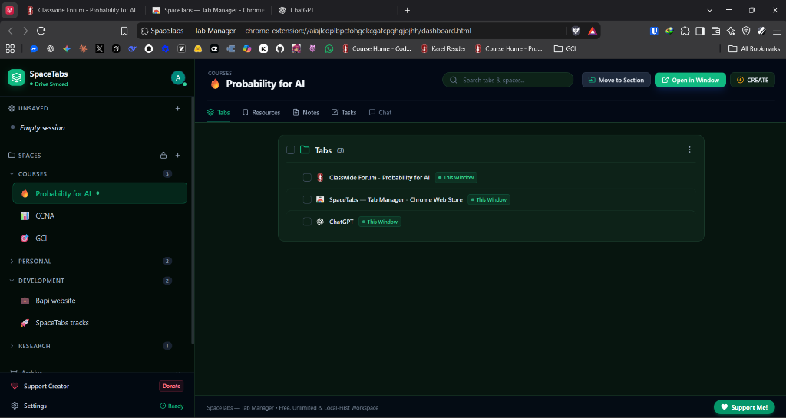
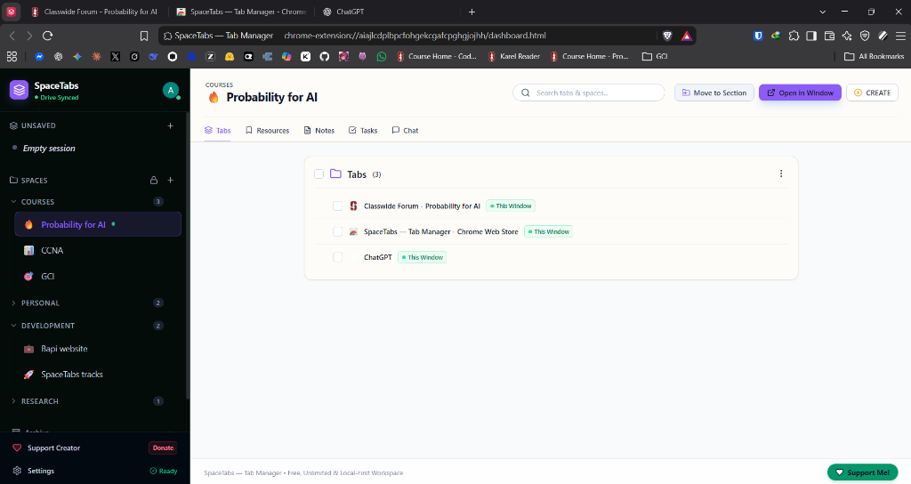
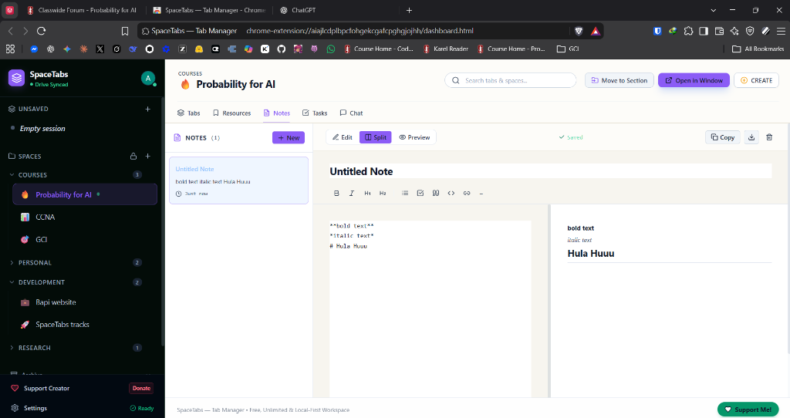
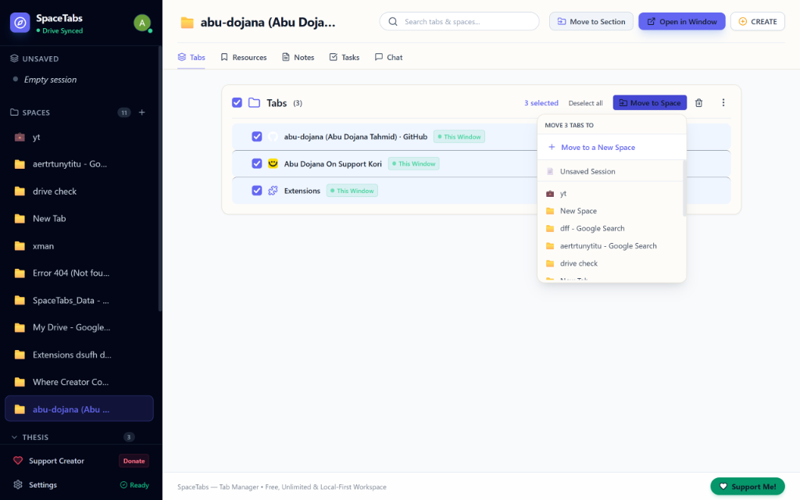
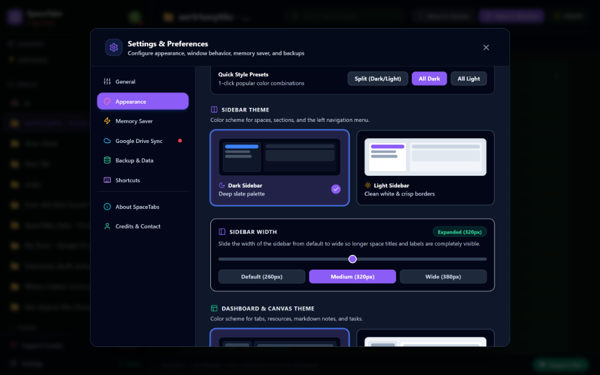
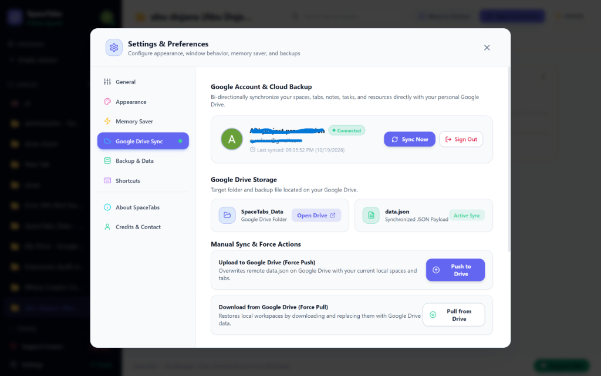
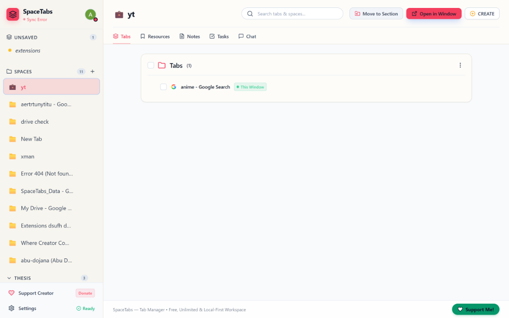
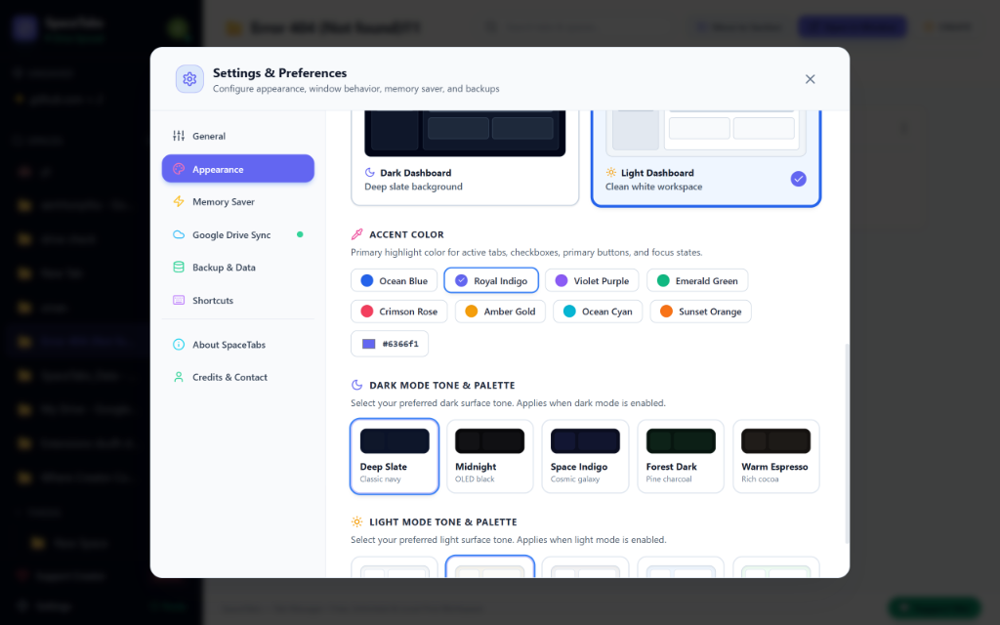

# SpaceTabs — Tab Manager 🚀

<p align="center">
  
</p>

<p align="center">
  <strong>The local-first, memory-saving workspace & tab manager for Chromium browsers.</strong><br />
  A fast, unlimited, privacy-respecting alternative to Workona and Tablerone with zero paywalls.
</p>

<p align="center">
  <a href="https://chromewebstore.google.com/detail/aiajlcdplbpcfohgekcgafcpghgjojhh?utm_source=item-share-cb">
    
  </a>
  
  
  
  
</p>

---

<p align="center">
  
</p>

---

## 💡 Why SpaceTabs?

Modern workflows involve dozens or hundreds of tabs across projects, research sessions, and work streams. Traditional browsers slow to a crawl, eat gigabytes of RAM, and cloud-based tab managers lock your data behind monthly subscriptions.

**SpaceTabs is designed differently:**
- **Local-First & Unlimited:** Store as many spaces, tabs, notes, and tasks as you need. All data lives in your browser's IndexedDB.
- **Save Up to 95% Memory:** Suspends cold-restored tabs to lightweight placeholders (~1 MB each) until clicked, with native Chrome `discard()` for idle open tabs.
- **Private Cloud Backup:** Sync directly with your personal Google Drive account using Google's secure `drive.file` scope across Chrome, Brave, and Chromium browsers. No third-party servers, no middleman databases.

---

## 📸 Screenshots & Showcase

| Workspace Dashboard (Dark Emerald) | Workspace Dashboard (Split Purple) |
| :---: | :---: |
|  |  |

| Built-in Markdown Notes Editor | Batch Tab Management |
| :---: | :---: |
|  |  |

| Appearance & Custom Themes | Google Drive Cloud Sync |
| :---: | :---: |
|  |  |

| Crimson Rose Light Theme | Accent Colors & Surface Palettes |
| :---: | :---: |
|  |  |

---

## ✨ Features

### 📂 Workspaces & Spaces
* **Unlimited Spaces:** Create, rename, color-code, and organize project spaces without limits.
* **Emoji Customization:** Choose custom emojis when creating or renaming spaces to visually identify workspaces at a glance.
* **Drag-and-Drop Sorting & Locking:** Easily reorder spaces via drag-and-drop, and lock their order with a single click to prevent accidental moves.
* **Workona-Style Multiple Unsaved Sessions:** Rapidly bucket open tabs into clean local scratchpad sessions with auto-generated domain badges and 1-click Quick-Save to permanent spaces.
* **Non-Destructive Space Switching:** Switching spaces cleanly stashes current tabs and restores the target space without losing work.
* **Multi-Window Support & Tab Controls:** Open individual tabs or batches of selected tabs in separate clean windows with 1 click.
* **Drag-and-Drop Organization:** Drag tabs from the canvas directly onto any Space or the Unsaved bucket in the sidebar.

### ⚡ Smart Memory Saver
* **Zero-RAM Cold Restores:** Restoring a space with 50+ tabs loads lightweight dormant placeholders (`suspended.html`) consuming only ~1 MB of RAM each and zero network bandwidth until focused or clicked.
* **Native Chrome Memory Discarding:** Automatically unloads memory from idle tabs using `chrome.tabs.discard()`, keeping tabs in place with full titles and favicons.
* **Configurable Auto-Suspend:** Choose inactivity timeouts (15m, 30m, 1h, 2h) or disable auto-suspension.
* **Domain Whitelisting:** Never suspend critical sites (e.g. YouTube, Google Meet, Slack, GitHub).

### ☁️ Google Drive Cloud Backup & Sync
* **Direct Cloud Sync:** Bi-directionally sync your spaces, tabs, notes, tasks, and resource bookmarks directly to a dedicated `SpaceTabs_Data` folder in your personal Google Drive.
* **Universal Browser Support:** Fully compatible with official Google Chrome, Brave, Edge, and other Chromium browsers.
* **Zero Middleman Servers:** Direct REST API calls from your browser to Google Drive — your data is never sent to third-party tracking servers.
* **Tombstone-Aware Merge:** Intelligent conflict resolution keeps track of deleted items so spaces deleted on one machine stay deleted across devices.
* **Manual & Auto-Sync:** Automated background sync plus one-click **Force Push** (overwrite cloud) and **Force Pull** (restore from cloud).
* **Local JSON Export/Import:** Instant offline backup and restore of your complete workspace.

### 📋 Space Canvas Tools
* **Tabs View:** Search, filter, domain grouping, multi-select checkboxes, and bulk move/delete/copy URLs.
* **Distraction-Free Mode:** Toggle web favicons on or off in Settings for a clean, minimalist reading layout.
* **Resources Hub:** Organize recurring documentation, links, and assets into categorized sections.
* **Notes:** Built-in markdown notes scratchpad per space with auto-saving, live split-pane preview, and formatting toolbar.
* **Tasks:** Space checklists with completion states and ordering.
* **Global Search:** Fast fuzzy search across all spaces, open tabs, notes, and resource items.

### 🎨 Themes & Customization
* **3 Theme Modes:** Split (Dark sidebar + Light canvas), All Dark, or All Light.
* **Accent Colors:** Crimson Rose, Indigo Blue, Emerald, Violet, Amber, Cyan.
* **Adjustable Sidebar Width:** Default (260px), Medium (320px), and Wide (380px) for long space titles.
* **Auto-Pinned Index Dashboard:** Always accessible at Tab 0 or via shortcut `Alt + Shift + W`.

---

## 🛠️ Tech Stack

* **Framework:** [WXT](https://wxt.dev/) (Vite + Web Extension Tools)
* **UI:** React 18, TypeScript, Tailwind CSS, Lucide Icons
* **Local Database:** [Dexie.js](https://dexie.org/) (IndexedDB with live reactive hooks)
* **Cloud Storage:** Google Drive REST API v3 (OAuth2 via `chrome.identity`)
* **State Management:** Dexie Live Queries + Zustand (ephemeral UI state)
* **Drag & Drop:** `@dnd-kit`

---

## 🚀 Installation

### Option 1: Chrome Web Store (Recommended)
Install the official extension from the [Chrome Web Store](https://chromewebstore.google.com/detail/aiajlcdplbpcfohgekcgafcpghgjojhh?utm_source=item-share-cb).

### Option 2: Install from Source (Developer Mode)

```bash
# 1. Clone the repository
git clone https://github.com/abu-dojana/SpaceTabs-TabManager.git
cd SpaceTabs-TabManager

# 2. Install dependencies
npm install

# 3. Build the production package
npm run build
```

1. Open Chrome/Brave/Edge and navigate to `chrome://extensions/`.
2. Enable **Developer mode** (top-right toggle).
3. Click **Load unpacked** and select the `dist` folder inside `SpaceTabs-TabManager`.

---

## ⌨️ Default Keyboard Shortcuts

| Shortcut | Action |
|---|---|
| `Alt + Shift + W` | Focus or open the pinned SpaceTabs Dashboard |

---

## 💖 Support the Developer

SpaceTabs is free, open-source, and developed independently. If it helps you stay organized and saves your RAM, consider supporting development:

- ☕ **Patreon:** [patreon.com/abudojana](https://patreon.com/abudojana)
- 🇧🇩 **SupportKori (bKash):** [supportkori.com/abudojana](https://www.supportkori.com/abudojana)
- ☕ **SociaBuzz:** [sociabuzz.com/abudojana/tribe](https://sociabuzz.com/abudojana/tribe)
- ⭐ **GitHub:** Star this repo and follow [@abu-dojana](https://github.com/abu-dojana)

---

## 📄 License

Distributed under the [MIT License](LICENSE). Local-first, open-source, and free forever.
