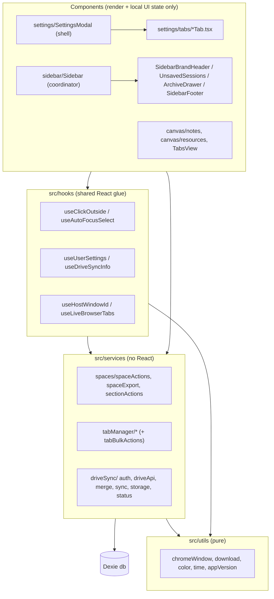

# SpaceTabs — Codebase Audit & Modularity Plan (v2)

## Goal

Break up the remaining monolithic files, remove duplicated logic, and move database/business logic out of React components into services. Keep **100% behavior parity**: no UI or feature changes, and no import-path breaks for existing consumers.

This builds on the earlier `refactor-monolith` work (tabManager, Sidebar, TabsView). It also adds a guard so files don't grow back into monoliths, which already happened to `Sidebar.tsx`.

---

## Audit Findings

### File size snapshot (actual line counts, `src/`)

| File | Lines | Status |
|---|---:|---|
| [SettingsModal.tsx](file:///d:/tab-manager/src/components/modals/SettingsModal.tsx) | **2,489** | 🔴 Never refactored. 8 tabs + 2 modals + toast in one component |
| [Sidebar.tsx](file:///d:/tab-manager/src/components/sidebar/Sidebar.tsx) | **1,425** | 🔴 Grew back (879 → 1,425) after the last refactor |
| [driveSync.ts](file:///d:/tab-manager/src/services/driveSync.ts) | **1,153** | 🔴 Auth + REST + merge + storage + status in one file |
| [NotesView.tsx](file:///d:/tab-manager/src/components/canvas/NotesView.tsx) | **1,031** | 🔴 Includes a ~285-line custom Markdown renderer |
| [ResourcesView.tsx](file:///d:/tab-manager/src/components/canvas/ResourcesView.tsx) | **978** | 🟠 Section, item, modal and dropdown all inline |
| [TabsView.tsx](file:///d:/tab-manager/src/components/canvas/TabsView.tsx) | **885** | 🟠 Grew back (684 → 885). Bulk tab actions live in the component |
| [Header.tsx](file:///d:/tab-manager/src/components/header/Header.tsx) | 551 | 🟡 Title/emoji editor could be extracted |
| [TasksView.tsx](file:///d:/tab-manager/src/components/canvas/TasksView.tsx) | 525 | 🟡 Low priority |
| [background.ts](file:///d:/tab-manager/src/entrypoints/background.ts) | 429 | 🟢 Acceptable |

### Duplicated logic

| Pattern | Copies | Locations |
|---|---:|---|
| Host window id: `tabs.getCurrent()?.windowId \|\| windows.getCurrent().id` | ~9 | App, Header ×2, Sidebar ×2, TabsView, tabOperations ×2, useWindowSpaces |
| Click-outside `mousedown` listener effect | 5+ | Sidebar, SpaceItem, Header, TabsView, ResourcesView |
| Focus + select input on edit-mode | 6+ | Sidebar ×2, TabsView, Header, TasksView, ResourcesView |
| **Space JSON export** (~60 lines each, hardcoded `version: '1.2.1'`) | 2 | [Sidebar.tsx#L557-L618](file:///d:/tab-manager/src/components/sidebar/Sidebar.tsx#L557-L618), [TabsView.tsx#L432-L500](file:///d:/tab-manager/src/components/canvas/TabsView.tsx#L432-L500) |
| Blob → `<a download>` boilerplate | 4 | Sidebar, TabsView, NotesView, settings.ts |
| `showTabFavicons` load + `storage.onChanged` subscription | 2 | TabsView, ResourcesView |
| `subscribeSyncStatus` → `useState` | 2 | Sidebar, SettingsModal |
| Settings → uiStore hydration (7 setters) | 2 | App.tsx, SettingsModal |
| LWW merge loop (local/remote/tombstone/parent-valid) | 6 | [driveSync.ts#L747-L846](file:///d:/tab-manager/src/services/driveSync.ts#L747-L846) |
| Theme option card markup (~40 lines each) | 4 | SettingsModal Appearance tab |
| Donation / social link card markup | ~10 | SettingsModal Contact tab |

### Correctness & hygiene issues (fixed along the way)

1. **`duplicateSpace` / `deleteSpacePermanently` are not atomic.** They make 10+ sequential awaits with no `db.transaction`, so a mid-way failure leaves partial data. They also use per-row `add()` in loops instead of `bulkAdd()`.
2. **Hardcoded `'1.2.1'`** in both space exports. This will be wrong on the next release. Use `chrome.runtime.getManifest().version`.
3. **Business logic inside components.** Sidebar and TabsView call `db.*` directly for duplicate, delete, reorder, sort and export, so none of it can be reused or tested.
4. **Mixed CRLF/LF line endings** inside the same file (e.g. `App.tsx`, `driveSync.ts`). Add `.gitattributes` + `.editorconfig`.
5. **No tests and no lint/size guard.** This is how `Sidebar.tsx` grew back.

### Pre-promotion issues (not code, but fix before Reddit)

> [!WARNING]
> - **`LICENSE` file is missing** while the README shows an MIT badge and links to `LICENSE` (404 on GitHub). r/opensource readers will notice.
> - **Memory claim is inconsistent**: the README says "up to 95%", FEATURES.md says "up to 80%". Pick one measured number (see the recording guide for how to measure it on camera).
> - FEATURES.md says "8 curated palettes" but lists 10.
> - Root clutter: `implementation_plan.md`, `tab_manager_plan.md` and `monolithic_refractoring_walkthrough.md` are committed at the repo root. Move them to `docs/dev/`.

✅ Good news: `client_secret*.json` files were **never committed** (checked with `git log --all`), there is no `dangerouslySetInnerHTML`/`innerHTML` anywhere, and `tsc --noEmit` passes cleanly today.

---

## User Review Required

> [!IMPORTANT]
> **Approach:** Work on a new branch `refactor/modularity-v2`, one commit per phase. After each phase, `tsc` and `wxt build` must pass, so any phase can be shipped or reverted on its own.

> [!IMPORTANT]
> **Public import paths stay stable.** `@/services/driveSync` and `@/components/modals/SettingsModal` keep working through barrel re-exports, following the existing `tabManager.ts` + `tabManager/` convention.

## Open Questions

> [!IMPORTANT]
> 1. **Scope:** Do all phases (0–5), or only the 🔴 items (Phases 0–4: foundations, services, driveSync, SettingsModal, Sidebar)?
> 2. **Tests:** Should I add **Vitest** (dev-only) with unit tests for the pure functions extracted here (LWW merge, Markdown parser, color utils, space export builder)? I recommend it: the merge logic protects user data and is currently untested.
> 3. **Size guard:** Add `scripts/check-file-size.js` (warn above 400 lines, fail above 600 in `src/`) as an `npm run lint:size` script?
> 4. **Hygiene extras:** Should I also add `LICENSE` (MIT, © Abu Dojana), `.gitattributes`/`.editorconfig`, and move the root plan docs to `docs/dev/`?

---

## Target Architecture



**Rule of thumb:** components never call `db.*` for multi-table writes. That goes through `services/`.

---

## Proposed Changes

### Phase 0: Shared foundations (low risk, removes most duplication)

#### [NEW] `src/utils/chromeWindow.ts`
```ts
/** Immutable host window of the current dashboard tab (falls back to focused window). */
export async function getHostWindowId(): Promise<number | null> {
  const tab = await chrome.tabs.getCurrent().catch(() => null);
  if (tab?.windowId) return tab.windowId;
  const win = await chrome.windows.getCurrent().catch(() => null);
  return win?.id ?? null;
}
```
This replaces about 9 inline copies. The services in `tabOperations.ts` use it too.

#### [NEW] `src/utils/download.ts`
`downloadFile(content: string, filename: string, mime = 'application/json')`. Replaces 4 copies.

#### [NEW] `src/utils/color.ts`
`hexToRgba`, `adjustBrightness`, moved verbatim from [App.tsx#L69-L89](file:///d:/tab-manager/src/entrypoints/dashboard/App.tsx#L69-L89).

#### [NEW] `src/utils/time.ts`
`formatRelativeTime` (from NotesView) and `formatDueDateBadge` (from TasksView).

#### [NEW] `src/utils/appVersion.ts`
`export const APP_VERSION = chrome.runtime.getManifest().version;`

#### [MODIFY] [wxt.config.ts](file:///d:/tab-manager/wxt.config.ts)
Remove the hardcoded `version: '1.2.1'` so WXT reads it from `package.json`. The version then lives in one place instead of four (package.json, wxt.config, 2× exports).

#### [NEW] `src/hooks/useClickOutside.ts`
```ts
export function useClickOutside(
  refs: React.RefObject<HTMLElement>[], onOutside: () => void, enabled = true, closeOnEscape = false
): void
```

#### [NEW] `src/hooks/useAutoFocusSelect.ts`
Focuses and selects an input when a condition becomes truthy.

#### [NEW] `src/hooks/useUserSettings.ts`
Loads `getUserSettings()` and subscribes to `storage.onChanged` (`spacetabs_user_settings`). TabsView/ResourcesView use it for `showTabFavicons`.

#### [NEW] `src/hooks/useDriveSyncInfo.ts`
Initial `getDriveSyncInfo()` + `subscribeSyncStatus`. Used by Sidebar and SettingsModal.

#### [NEW] `src/hooks/useHydrateUiFromSettings.ts`
Copies saved settings into `uiStore` (theme, accent, palettes, width, patreon). Used by App and SettingsModal.

#### [MODIFY] App, Header, Sidebar, SpaceItem, TabsView, ResourcesView, NotesView, TasksView, tabOperations, useWindowSpaces, settings.ts
Replace inline copies with the helpers above. No behavior change.

---

### Phase 1: Services layer (move DB logic out of components)

#### [NEW] `src/services/spaces/spaceActions.ts`
- `duplicateSpace(space)`: wrapped in **one `db.transaction`**, using `bulkAdd` for tabs/notes/tasks/resources (fixes atomicity, and is faster).
- `deleteSpacePermanently(spaceId)`: records tombstones, then cascades deletes inside a transaction.
- `archiveSpace`, `restoreSpace`, `renameSpace`.

#### [NEW] `src/services/spaces/spaceExport.ts`
```ts
export async function buildSpaceExport(spaceId: string): Promise<SpaceExportPayload>
export async function exportSpaceToFile(spaceId: string): Promise<void> // uses downloadFile + APP_VERSION
```
Deletes both duplicated ~60-line implementations.

#### [NEW] `src/services/spaces/sectionActions.ts`
`renameSection`, `archiveSectionSpaces`, `keepSectionSpaces`, `persistSectionOrder`, `reorderSpaces`. Moved from [Sidebar.tsx#L409-L800](file:///d:/tab-manager/src/components/sidebar/Sidebar.tsx#L409-L800).

#### [NEW] `src/services/tabManager/tabBulkActions.ts`
`reorderTabsAndSyncBrowser`, `sortTabsAlphabetically`, `sortTabsByDomain`, `closeDuplicateTabs`, `suspendAllTabsInWindow`, `reloadAllTabsInWindow`, `closeAllTabs`, `copyLinks`. Moved from [TabsView.tsx#L298-L640](file:///d:/tab-manager/src/components/canvas/TabsView.tsx#L298-L640).

#### [MODIFY] [tabManager.ts](file:///d:/tab-manager/src/services/tabManager.ts)
Add the `tabBulkActions` re-export.

---

### Phase 2: `driveSync.ts` → `src/services/driveSync/`

| New file | Contents (from current `driveSync.ts`) | ~Lines |
|---|---|---:|
| `types.ts` | `GoogleUserProfile`, `CloudSyncSettings`, `SyncStatus`, `DriveSyncInfo`, `DEFAULT_SYNC_SETTINGS` | 70 |
| `storage.ts` | tombstones, profile, cloud settings, sync meta (L83–L250) | 170 |
| `status.ts` | listener set, `subscribeSyncStatus`, `setSyncStatus`, `notifyStatusChange` | 50 |
| `auth.ts` | `WEB_OAUTH_CLIENT_ID`, `getAuthToken`, `runWithAuthRetry`, custom OAuth flow, sign in/out (L283–L525) | 250 |
| `driveApi.ts` | `ensureDriveFolder`, `findDataFile`, `downloadRemoteData`, `uploadDataToDrive` | 170 |
| `merge.ts` | `buildLocalExport`, **generic `mergeCollection<T>()`**, `mergeRemoteAndLocal` | 150 (was 240) |
| `sync.ts` | `syncNow`, `forcePushToDrive`, `forcePullFromDrive` | 200 |
| `alarm.ts` | `DRIVE_SYNC_ALARM`, `setupDriveSyncAlarm` | 25 |

The six copy-pasted merge loops collapse into one pure, testable function:
```ts
export function mergeCollection<T extends { id: string; updatedAt: number }>(
  local: T[] = [], remote: T[] = [], deleted: Set<string>, isValid: (row: T) => boolean
): Map<string, T> {
  const out = new Map<string, T>();
  for (const r of local) if (!deleted.has(r.id) && isValid(r)) out.set(r.id, r);
  for (const r of remote) {
    if (deleted.has(r.id) || !isValid(r)) continue;
    const cur = out.get(r.id);
    if (!cur || r.updatedAt > cur.updatedAt) out.set(r.id, r);
  }
  return out;
}
```

#### [MODIFY] `src/services/driveSync.ts` → barrel (~15 lines)
Re-exports every current public symbol, so `background.ts`, Sidebar, SettingsModal and others are untouched.

---

### Phase 3: `SettingsModal.tsx` (2,489) → `src/components/settings/`

```
src/components/settings/
├── SettingsModal.tsx          # shell: backdrop, header, left nav, tab router (~180)
├── settingsTabs.ts            # tab ids, labels, icons (typed SettingsTabId)
├── useSettingsController.ts   # settings state, update helpers, toast
├── ui/
│   ├── SettingsToast.tsx
│   ├── SectionHeading.tsx     # icon + title + description (used ~20×)
│   ├── ToggleRow.tsx          # label + description + switch
│   ├── ThemeOptionCard.tsx    # dedupes the 4 sidebar/dashboard theme cards
│   └── LinkCard.tsx           # dedupes ~10 donation/social cards
├── tabs/
│   ├── GeneralTab.tsx
│   ├── AppearanceTab.tsx      # composes SidebarWidthControl, AccentPicker, PalettePicker
│   ├── appearance/{SidebarWidthControl,AccentPicker,PalettePicker,QuickPresets}.tsx
│   ├── SuspensionTab.tsx
│   ├── CloudSyncTab.tsx       # + cloud/{AccountCard,DriveFilesCard,ManualSyncCard,AutoSyncPrefs}.tsx
│   ├── ConfirmPullModal.tsx
│   ├── BackupTab.tsx
│   ├── ShortcutsTab.tsx
│   ├── AboutTab.tsx
│   └── ContactTab.tsx
└── data/
    ├── changelog.ts           # "What's New" entries as data, not JSX
    └── contactLinks.ts        # donation + social links as data
```
#### [MODIFY] `src/components/modals/SettingsModal.tsx` → `export { SettingsModal } from '@/components/settings/SettingsModal';`

Target: no file over ~400 lines. Release notes become a data edit instead of JSX surgery.

---

### Phase 4: `Sidebar.tsx` (1,425) → coordinator (~350)

| New file | Extracted from |
|---|---|
| `sidebar/hooks/useSidebarSpaces.ts` | live queries, unsaved tab map, section grouping/sorting (L115–L213) |
| `sidebar/hooks/useSpaceDragReorder.ts` | space + section drag state and drop handlers (L52–L68, L674–L880) |
| `sidebar/SidebarBrandHeader.tsx` | brand, avatar, sync indicator (L955–L1052) |
| `sidebar/UnsavedSessionsSection.tsx` | Unsaved bucket list (L1055–L1204) |
| `sidebar/ArchiveDrawer.tsx` | archive drawer (L1304–L1369) |
| `sidebar/SidebarFooter.tsx` | Support + Settings buttons (L1370–L1406) |

The action handlers become thin wrappers around the Phase 1 services.

---

### Phase 5: Canvas views

#### NotesView (1,031) → `src/components/canvas/notes/`
- `markdown/MarkdownRenderer.tsx` + `markdown/parseMarkdown.ts` (pure parser, testable). From L53–L335.
- `useNoteEditor.ts`: buffers, refs, 500 ms debounce, flush-on-unmount/switch (L353–L540). **Highest-risk extraction: the lossless-save guarantees must be preserved exactly.**
- `NotesList.tsx`, `NoteTopToolbar.tsx`, `FormattingToolbar.tsx`, `DeleteNoteModal.tsx`
- `NotesView.tsx` (~200)

#### ResourcesView (978) → `src/components/canvas/resources/`
`ResourceSectionCard.tsx`, `ResourceItemRow.tsx`, `ResourceModal.tsx`, `AddFromOpenTabsDropdown.tsx`, `useResourceActions.ts`, `resourceUtils.ts` (`detectResourceType`, icon renderer), `ResourcesView.tsx` (~250).

#### TabsView (885) → ~400
Bulk actions are already gone (Phase 1). Extract `hooks/useLiveBrowserTabs.ts` (L126–L186) and `TabsHeader.tsx` (L658–L752).

#### Optional (if scope = all)
- `Header.tsx` → `SpaceTitleEditor.tsx` (L227–L417) + `ViewTabs.tsx`
- `TasksView.tsx` → `TaskItem.tsx`, `TaskAddForm.tsx`

---

### Phase 6: Guards & hygiene (pending answers to Q2–Q4)
- [NEW] `scripts/check-file-size.js` + `"lint:size"` script
- [NEW] `vitest.config.ts`, `src/**/__tests__/*.test.ts` for `mergeCollection`, `mergeRemoteAndLocal`, `parseMarkdown`, `color`, `buildSpaceExport` (with `fake-indexeddb`)
- [NEW] `LICENSE`, `.gitattributes` (`* text=auto eol=lf`), `.editorconfig`
- Move root plan docs → `docs/dev/`

---

## Expected outcome

| File | Before | After (target) |
|---|---:|---:|
| SettingsModal | 2,489 | ~180 (shell) |
| Sidebar | 1,425 | ~350 |
| driveSync | 1,153 | ~15 (barrel) + 8 modules ≤ 250 |
| NotesView | 1,031 | ~200 |
| ResourcesView | 978 | ~250 |
| TabsView | 885 | ~400 |

---

## Verification Plan

### Automated (after every phase)
```powershell
npm run compile        # tsc --noEmit, must stay at 0 errors
npm run build          # wxt build + copy to dist/
npm run test           # if Vitest approved
npm run lint:size      # if size guard approved
```

### Manual smoke checklist (load unpacked `dist/` in Chrome + Brave)
| Phase | Check |
|---|---|
| 0 | Accent color/hover renders. Click-outside closes space menu, tab move dropdown, resource menus and emoji picker. Favicon toggle updates Tabs + Resources live. |
| 1 | Duplicate a space with tabs/notes/tasks/resources and verify every item copied. Delete a space and confirm it stays deleted after Drive sync on a second profile. Export a space from both the sidebar menu and the Tabs ⋮ menu: identical JSON with the correct version. Sort A–Z / by domain reorders the real tab strip. Close duplicates. Suspend all. |
| 2 | Sign in (Chrome native + Brave WebAuthFlow). Sync now. Force push / force pull. Auto-sync alarm fires. Status dot in sidebar updates. |
| 3 | Every settings tab renders in light and dark. Each toggle persists after reload. Import/export backup. Pull confirmation modal. Toast appears. |
| 4 | Drag-reorder spaces and sections. Lock toggle. Unsaved sessions create/delete/select. Archive/restore. Multi-window dots. |
| 5 | Type in a note and switch notes/spaces immediately: no lost text. Ctrl+S/B/I. Checklist toggle in preview. Resources CRUD + drag between sections + add from open tabs. |
