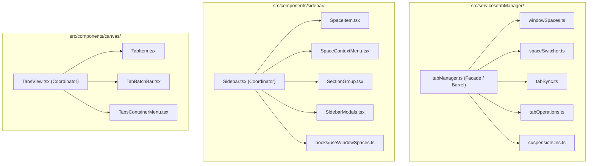

# Codebase Refactoring Summary: Decomposing the Monoliths

All 3 phases of decomposing the monolithic files have been successfully completed and compiled with **0 errors**.

## 1. Summary of Changes



### Metrics & Line Count Reduction

| File / Component | Before | After | Reductions & Extracted Submodules |
|---|---|---|---|
| [`src/services/tabManager.ts`](file:///d:/tab-manager/src/services/tabManager.ts) | 733 lines | **10 lines** | Extracted into [`windowSpaces.ts`](file:///d:/tab-manager/src/services/tabManager/windowSpaces.ts), [`spaceSwitcher.ts`](file:///d:/tab-manager/src/services/tabManager/spaceSwitcher.ts), [`tabSync.ts`](file:///d:/tab-manager/src/services/tabManager/tabSync.ts), [`tabOperations.ts`](file:///d:/tab-manager/src/services/tabManager/tabOperations.ts), and [`suspensionUrls.ts`](file:///d:/tab-manager/src/services/tabManager/suspensionUrls.ts). Retains 100% backward-compatible re-exports. |
| [`src/components/sidebar/Sidebar.tsx`](file:///d:/tab-manager/src/components/sidebar/Sidebar.tsx) | 1,491 lines | **879 lines** | Extracted [`SpaceItem.tsx`](file:///d:/tab-manager/src/components/sidebar/SpaceItem.tsx), [`SpaceContextMenu.tsx`](file:///d:/tab-manager/src/components/sidebar/SpaceContextMenu.tsx), [`SectionGroup.tsx`](file:///d:/tab-manager/src/components/sidebar/SectionGroup.tsx), [`SidebarModals.tsx`](file:///d:/tab-manager/src/components/sidebar/SidebarModals.tsx), and [`useWindowSpaces.ts`](file:///d:/tab-manager/src/components/sidebar/hooks/useWindowSpaces.ts). |
| [`src/components/canvas/TabsView.tsx`](file:///d:/tab-manager/src/components/canvas/TabsView.tsx) | 1,192 lines | **684 lines** | Extracted [`TabItem.tsx`](file:///d:/tab-manager/src/components/canvas/TabItem.tsx), [`TabBatchBar.tsx`](file:///d:/tab-manager/src/components/canvas/TabBatchBar.tsx), and [`TabsContainerMenu.tsx`](file:///d:/tab-manager/src/components/canvas/TabsContainerMenu.tsx). |

---

## 2. Verification Results & Indicator Fixes (Commit `c9c96c2`)

### Issues Diagnosed & Resolved:
1. **Sync Indicator Missing in Header:**
   - The brand header in [`Sidebar.tsx`](file:///d:/tab-manager/src/components/sidebar/Sidebar.tsx) had accidentally replaced the live `syncInfo` connection status button with a static `Local-First` text.
   - **Fix:** Restored full dynamic sync indicator (`Drive Synced` with green dot, `Syncing...` with spinner, `Sync Error` with red dot, or `Local-First` with gray dot) along with the user avatar picture/initial and sync status dot.
2. **Multi-Window Space Indicators (Green / Purple Dots) Disappearing in First Window:**
   - Both `useWindowSpaces` and `TabsView` were listening to `chrome.windows.onFocusChanged` and re-running `chrome.windows.getCurrent()`.
   - In Chromium MV3, when Window 2 is focused, calling `chrome.windows.getCurrent()` inside Window 1's event callback returns **Window 2's ID**, actively corrupting Window 1's `currentWindowId`!
   - **Fix:** Each dashboard tab now reliably anchors its host window ID once on mount using `chrome.tabs.getCurrent().windowId` (which is 100% immutable and never changes regardless of which window has focus). Focus changes no longer clobber the window ID.
3. **Tab Indicators (`This Window` / `Another Window`) Missing:**
   - If a tab in Dexie had a stale `chromeTabId` (or had not yet been assigned one across restarts), `TabsView` failed to identify it.
   - **Fix:** Added fallback URL matching against open browser tabs (`decodeRealUrl(tab.url)`), guaranteeing that open tabs in this or other windows are immediately badged even if tab IDs changed across browser restarts.
4. **Session Space Map Query:**
   - Updated `getAllWindowSpaces()` in [`windowSpaces.ts`](file:///d:/tab-manager/src/services/tabManager/windowSpaces.ts) to retrieve `chrome.storage.session.get(null)` so all active window spaces are fetched atomically.
5. **Archived Spaces Filter:**
   - Re-added `filter((s) => !s.isArchived)` to `db.spaces.orderBy('order')` query in `Sidebar.tsx`.

---

## 3. How to Test in Browser

1. Open Chrome/Brave/Edge/Vivaldi extensions page (`chrome://extensions`).
2. Make sure **Developer Mode** is toggled ON.
3. Click the reload icon (🔄) on **SpaceTabs** (or load unpacked from `d:\tab-manager\dist`).
4. Test key features:
   - Click between spaces in the sidebar.
   - Test "Suspend Tabs on Space Switch" ON/OFF toggle in Settings.
   - Open a space in another window and verify the purple active dot and crosshair focus button.
   - Select multiple tabs in the canvas and verify batch actions (Move, Suspend, Copy URLs, Close).
   - Use the 3-dot space menu to rename, duplicate, or delete a space.

---

## 4. Git Commands

### Option A: If you're happy with the refactoring and want to merge & push:
```powershell
git checkout main
git merge refactor-monolith
git push origin main
```

### Option B: If you ever want to revert back to before the refactoring:
```powershell
git checkout main
git branch -D refactor-monolith
```
*(Your `main` branch remains 100% untouched at tag `v1.0.1-stable` until merged).*
