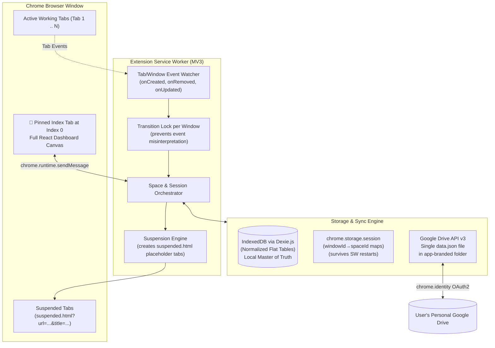
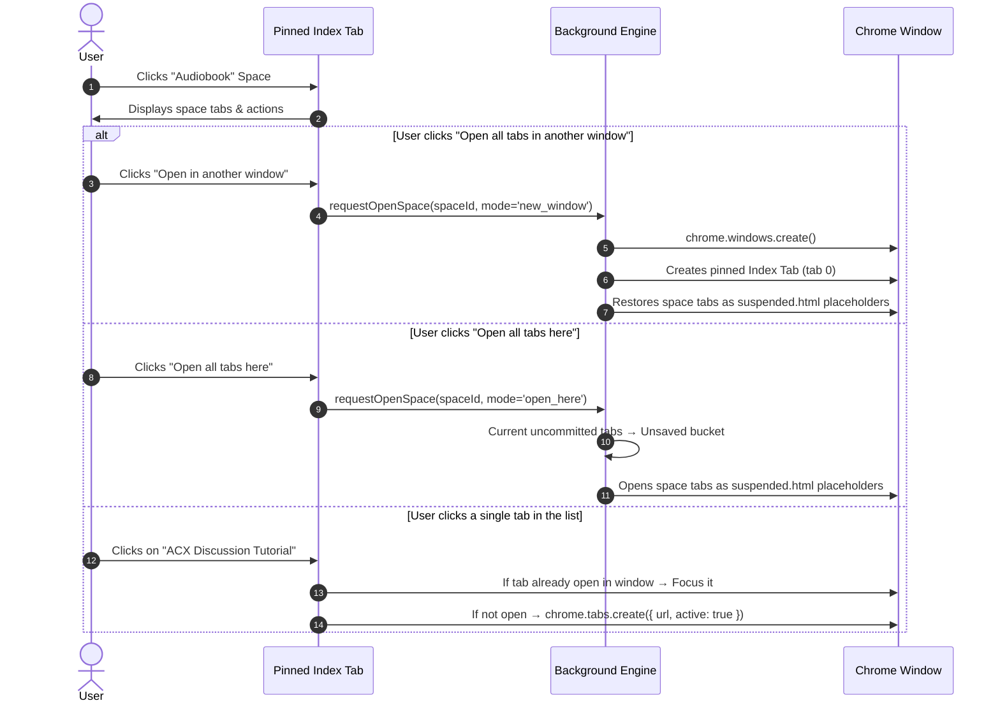
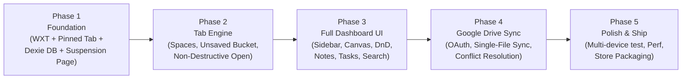

# Modern Tab & Workspace Manager — Architectural Blueprint & Roadmap (v3 — Reviewed & Fixed)

> [!IMPORTANT]
> This is the reviewed and corrected version of the plan. All technical flaws from v2 have been addressed. Changes from v2 are marked with 🔧 throughout.

---

## 1. Executive Summary & Core Philosophies

This project is a high-performance, privacy-respecting tab and workspace manager extension designed to deliver the best aspects of **Workona** and **Tablerone** while eliminating their major annoyances:

1. **User-Owned Cloud Sync (Tablerone Model via Google Drive):**
   * Users sign in with their Google account via standard OAuth (`chrome.identity`).
   * The extension creates a dedicated folder in the user's personal Google Drive where workspace states, tabs, resources, and notes are synced.
   * **Anywhere in the world**, logging into the extension on a fresh browser immediately syncs all spaces. Zero proprietary servers, zero subscriptions, 100% user data ownership.
   * **Local Backup & Restore:** Full offline support with one-click JSON import/export.
2. **Unlimited Spaces:**
   * No 5-space paywall. Users can create infinite project spaces.
3. **The Pinned "Index Tab" with Favicon (Primary UI):**
   * Just like Workona and Tablerone, the first tab in the window (index `0`) is automatically pinned as the **Index Tab / Dashboard** displaying a clean icon.
   * Clicking the pinned tab opens the full dashboard canvas. (Chrome Side Panel is available as an optional toggle in Settings but is **not** the primary interface.)
4. **Non-Destructive Space Opening (Full User Control):**
   * Unlike Workona's abrupt behavior of closing all existing tabs, our manager gives explicit control:
     * **"Open all tabs here"** — opens space tabs alongside (or replaces) current tabs, safely stashing previous open tabs into the Unsaved bucket.
     * **"Open all tabs in another window"** — spawns an isolated window for that project space.
     * **Clicking an individual tab** — opens that specific tab directly or focuses it if already open.
5. **No "Hidden Tabs" Ghost Window Hack:**
   * Workona leaves a ghost browser window open (`workona.com/inactive/`) which annoys users upon closing Chrome.
   * We completely reject this. Tab states are serialized to **IndexedDB** and synced to **Google Drive**. Tabs are restored on-demand using a lightweight **local suspension page**. No phantom windows.

---

## 2. Feature Comparison Matrix

| Feature | Workona | Tablerone | Our Tab Manager |
| :--- | :--- | :--- | :--- |
| **Space Limit** | 5 spaces (Free) / Paid for more | Unlimited | **Unlimited (Always Free)** |
| **Cloud Sync** | Proprietary Cloud (\$8–\$12/mo) | Google Drive Backup | **Personal Google Drive Sync (Auto)** |
| **Local Export / Import** | Limited | JSON Export | **Full JSON Export & Import** |
| **Primary Interface** | Pinned Tab + Dashboard | Pinned Tab / New Tab | **Pinned Index Tab (Tab 0) + Dashboard** |
| **Space Opening Mode** | Destructive / Force switches | Session Restore | **Flexible ("Open Here", "New Window", Single Click)** |
| **Inactive Tabs Window** | ❌ Ghost `inactive/` window | None | **Clean lifecycle (No ghost windows)** |
| **Tab Suspension** | Custom suspension script | Sleep mode | **Local suspension page (zero RAM)** |
| **Context Tools** | Notes, Tasks, Resources | Tags, Notes | **Saved Resources, Markdown Notes, Tasks** |

---

## 3. High-Level Architecture (Manifest V3)



### Tech Stack

| Layer | Technology | Rationale |
| :--- | :--- | :--- |
| Extension framework | **WXT** (Vite-based) | MV3-native, hot reload, multi-browser output |
| UI framework | **React 18/19 + Tailwind CSS + shadcn/ui** | Fast, composable, headless components |
| State management | **Zustand** | Lightweight, works across extension contexts |
| Local database | **Dexie.js** (IndexedDB) | Transactions, indexes, normalized tables |
| Transient state | `chrome.storage.session` | Survives service worker restarts, cleared on browser close |
| Search | **Fuse.js** | Client-side fuzzy matching |
| Drag and drop | **@dnd-kit** | Accessible, performant reordering |
| Build target | Chrome, Edge, Brave, Firefox (via WXT) | |

---

## 4. Detailed Component Design

### A. The Pinned "Index Tab" Engine

**Behavior:**
* When a window opens or the extension initializes, the service worker ensures tab index `0` is the Dashboard URL (`chrome-extension://<id>/dashboard.html`) and is marked `pinned: true`.
* The pinned tab has a distinct, crisp favicon matching the extension logo.
* If a user accidentally closes the pinned index tab, the extension immediately recreates it.
* Keyboard shortcut to focus the dashboard: **`Alt+Shift+W`** 🔧 *(changed from `Alt+Space` which is reserved by Windows for the system menu)*.

**🛡️ Zombie Window & Popup Trap Guards:**

> [!CAUTION]
> Two native Chrome behaviors will cause crashes or ghost windows if not handled:
> 1. Closing a window fires `tabs.onRemoved` for every tab — naively recreating the pinned tab will resurrect a dying window.
> 2. `chrome.windows.onCreated` fires for **all** window types: OAuth popups, DevTools, Picture-in-Picture, PWA frames.

* **Guard 1 — Window Close Detection:** In `chrome.tabs.onRemoved`, always check `if (removeInfo.isWindowClosing) return;` before attempting to recreate the pinned tab.
* **Guard 2 — Window Type Filtering:** In `chrome.windows.onCreated`, only inject the pinned index tab when `window.type === 'normal'`. Skip `popup`, `panel`, `devtools`, and `app` window types entirely.
* **Guard 3 — Startup Deduplication & Idempotency ("Continue Where You Left Off"):** When Chrome restores a prior session, it may restore a previous `dashboard.html` tab while also triggering window/startup creation. Before calling `chrome.tabs.create`, always query `chrome.tabs.query({ windowId })` to verify whether a dashboard tab already exists. Additionally, in `chrome.tabs.onUpdated`, if more than one dashboard tab is detected in the same window, immediately close the duplicate.

```typescript
const DASHBOARD_URL = chrome.runtime.getURL('/dashboard.html');

// In tabs.onRemoved listener:
chrome.tabs.onRemoved.addListener((tabId, removeInfo) => {
  if (removeInfo.isWindowClosing) return; // ← Critical: don't resurrect dying windows
  // Check if removed tab was pinned dashboard, verify none remain, then recreate
});

// Idempotent Pinned Tab Ensure helper:
async function ensurePinnedIndexTab(windowId: number) {
  const win = await chrome.windows.get(windowId).catch(() => null);
  if (!win || win.type !== 'normal') return;

  const tabs = await chrome.tabs.query({ windowId });
  const dashboardTabs = tabs.filter(t => t.url?.startsWith(DASHBOARD_URL));

  if (dashboardTabs.length === 0) {
    // None exists: create pinned at index 0
    await chrome.tabs.create({ windowId, url: DASHBOARD_URL, pinned: true, index: 0 });
  } else if (dashboardTabs.length > 1) {
    // Deduplicate: keep the first, close extra duplicates
    const [keep, ...duplicates] = dashboardTabs;
    if (!keep.pinned) await chrome.tabs.update(keep.id!, { pinned: true });
    for (const dup of duplicates) {
      if (dup.id) await chrome.tabs.remove(dup.id);
    }
  } else if (!dashboardTabs[0].pinned) {
    await chrome.tabs.update(dashboardTabs[0].id!, { pinned: true });
  }
}

// In windows.onCreated listener:
chrome.windows.onCreated.addListener((window) => {
  if (window.type !== 'normal' || !window.id) return;
  ensurePinnedIndexTab(window.id);
});

// In tabs.onUpdated listener (catches late-restored duplicates):
chrome.tabs.onUpdated.addListener((tabId, changeInfo, tab) => {
  if (tab.url?.startsWith(DASHBOARD_URL) && tab.windowId) {
    ensurePinnedIndexTab(tab.windowId);
  }
});
```

**🔧 Multi-Window Behavior:**
* **Each Chrome window of type `'normal'` independently gets its own pinned index tab** at index `0`.
* Each window can have its own active space context.
* The mapping of `windowId → activeSpaceId` is stored in `chrome.storage.session` (survives service worker restarts but clears when the browser closes — which is correct, since the "active space" is a transient runtime concept).

**Dashboard Layout (Inside Pinned Tab):**
* **Left Sidebar:**
  * User profile / Google avatar / sync status indicator.
  * **Unsaved Tabs section:** Catch-all bucket of tabs not committed to any named space, grouped by domain (e.g., "youtube.com + 3"). See Section 4E for full definition.
  * **Spaces list:** "Power BI", "Audiobook", "Thesis", etc., with drag-and-drop ordering, counter badges, and color/emoji icons.
  * **Archive** section for soft-deleted spaces.
* **Top Action Bar:**
  * Space title (editable inline).
  * Search bar (instant fuzzy search across all spaces, resources, notes, and history).
  * Quick Action Buttons: **"Open all tabs here"**, **"Open in new window"**, **"Save current tabs to this space"**.
  * Sub-navigation: `Tabs` | `Resources` | `Notes` | `Tasks`.
* **Main Canvas:**
  * Clean checklist of saved tabs with favicons, titles, and individual action menus (Open, Copy URL, Delete, Move to Space).
  * Categorized resource blocks (e.g. "Reference Links", "Docs").

---

### B. 🔧 Tab Suspension Engine (Hybrid Strategy)

> [!WARNING]
> **`chrome.tabs.discard()` cannot work on freshly created tabs.** Chrome requires a tab to have fully loaded at least once before it can be discarded. Calling `discard()` on a tab that has never completed loading fails silently.

**Two distinct suspension mechanisms for two different scenarios:**

#### B1. Cold Restore: `suspended.html` (for restoring saved spaces)

When restoring a space with 20+ tabs, the extension creates each tab pointing to a local placeholder:

```
chrome-extension://<id>/suspended.html?url=<encoded_real_url>&title=<encoded_title>&favicon=<encoded_icon>
```

**How it works:**
1. The extension creates each tab pointing to `suspended.html` with the real URL, title, and favicon encoded in query parameters.
2. `suspended.html` is a tiny static page (~2KB) that:
   * Sets the document title to the original tab's title (so the tab strip looks correct).
   * Displays a minimal "Click to load" message or the page title.
   * Uses a `<link rel="icon">` to show the original favicon.
   * On user click or focus, executes `location.replace(realUrl)` to navigate to the actual page.
3. **Result:** 20 tabs restored = 20 × 2KB of RAM instead of 20 full page loads. Zero network traffic until the user actually clicks a tab.

#### B2. Auto-Suspend Idle Tabs: Native `chrome.tabs.discard()` (for already-loaded tabs)

> [!CAUTION]
> Using `suspended.html` for auto-suspending **already-loaded** tabs has two serious drawbacks:
> 1. Navigating an active tab to `suspended.html` and back via `location.replace()` **destroys the tab's Forward/Back session history**, scroll position, and any unsubmitted form state.
> 2. If the user **disables or uninstalls** the extension while tabs are sitting on `chrome-extension://<id>/suspended.html`, Chrome **permanently closes every one of those tabs** because the extension URL becomes invalid.

**Fix — Use native `chrome.tabs.discard()` for idle tabs:**
* Configurable idle timeout (e.g., 30 minutes of inactivity).
* Since the tab has already been fully loaded and rendered, `chrome.tabs.discard(tabId)` works reliably.
* Discarded tabs **preserve** back-button history, native favicons, and session state.
* Discarded tabs **survive** extension uninstalls and updates.
* Chrome automatically reloads a discarded tab when the user clicks on it.

```typescript
// Hybrid suspension decision:
function suspendTab(tabId: number, isRestoringSpace: boolean) {
  if (isRestoringSpace) {
    // Cold restore → use suspended.html placeholder (tab never loaded)
    chrome.tabs.update(tabId, { url: buildSuspendedUrl(originalUrl, title, favicon) });
  } else {
    // Auto-suspend idle tab → use native discard (tab already loaded)
    chrome.tabs.discard(tabId).catch(() => {
      // Fallback: tab might be active or playing audio; skip silently
    });
  }
}
```

#### B3. Favicon Resolution & Anti-Bloat Strategy (MV3 `_favicon` API)

> [!TIP]
> Never store Base64 data-URIs on `Tab` objects. Serializing dozens of raw images into `data.json` bloats the Google Drive sync payload from ~50KB to multiple megabytes.

* Request the `"favicon"` permission in `manifest.json`.
* In both the Dashboard UI and `suspended.html`, render favicons via Chrome's native cache endpoint:
  ```
  chrome-extension://<id>/_favicon/?pageUrl=${encodeURIComponent(url)}&size=32
  ```
* In IndexedDB and Google Drive, keep `favIconUrl` strictly as a lightweight string (remote URL or empty string). Chrome handles the local icon caching automatically.

---

**Authentication:**

> [!IMPORTANT]
> **`chrome.identity.getAuthToken` is Chrome-only.** It relies on Google's native Chrome profile integration and is completely unsupported in Firefox and fails by default in Brave (which strips Google account integration).

* **Primary (Chrome/Edge):** Uses `chrome.identity.getAuthToken({ interactive: true })` — seamless, uses the browser's built-in Google profile.
* **Fallback (Brave/Firefox):** Uses `chrome.identity.launchWebAuthFlow()` with **Authorization Code + PKCE** flow (`response_type=code`). Exchanges the authorization code for both an `access_token` and a `refresh_token`.
  * The `refresh_token` is securely persisted in `chrome.storage.local`.
  * The Drive API client automatically refreshes the `access_token` when expired or upon receiving an HTTP `401 Unauthorized`, avoiding hourly re-login prompts.
* OAuth scope: `https://www.googleapis.com/auth/drive.file` — strictly limited to files created by the extension itself.

```typescript
// Cross-browser auth abstraction with PKCE & refresh token:
async function getValidAccessToken(interactive = false): Promise<string> {
  // 1. Try Chrome native identity
  try {
    return await chrome.identity.getAuthToken({ interactive });
  } catch {
    // 2. Fallback: Brave / Firefox with PKCE + Refresh Token
    const stored = await chrome.storage.local.get(['refreshToken', 'accessToken', 'tokenExpiry']);
    if (stored.accessToken && Date.now() < stored.tokenExpiry - 60_000) {
      return stored.accessToken;
    }
    if (stored.refreshToken) {
      return await refreshAccessToken(stored.refreshToken);
    }
    if (!interactive) throw new Error('Auth required');
    return await startPKCEAuthFlow(); // launches web popup, exchanges code for tokens
  }
}
```

**🔧 Single-File Sync (Replaces Per-Space File Splitting):**

> [!NOTE]
> The v2 plan proposed separate `tabs_<spaceId>.json` files per space. With 30+ spaces this means 30+ API calls per sync cycle, hitting Google Drive's rate limit (~10 req/s for free tier). A typical user's full dataset is well under 1MB of JSON. A single file roundtrip is far more reliable.

**Data Structure on Google Drive:**
```
📁 <AppName>_Data/              ← branded folder, auto-created
   📄 data.json                 ← single file: all spaces, tabs, resources, notes, tasks
   📄 sync_manifest.json        ← version, timestamp, deviceId, checksum
```

**Sync Workflow:**
1. **Folder & File Initialization (Race-Condition Proof):**
   * Google Drive allows multiple folders/files with the exact same name. If multiple devices initialize concurrently, duplicate `<AppName>_Data` folders can be created.
   * **Fix:** When querying Drive, always use:
     ```
     q: "name = '<AppName>_Data' and mimeType = 'application/vnd.google-apps.folder' and trashed = false"
     orderBy: 'createdTime asc'
     ```
   * Always select the **oldest** entry (`createdTime asc`) as canonical.
   * Cache resolved `folderId` and `fileId` in `chrome.storage.local`.
   * Subsequent updates bypass folder search and patch directly via `PATCH https://www.googleapis.com/upload/drive/v3/files/{fileId}?uploadType=media`.
2. **Local Save (Immediate):** Every meaningful change writes to IndexedDB **immediately** — no debouncing on local writes. This guarantees zero data loss even if the browser crashes or the service worker is killed.
3. **🔧 Drive Push (Debounced — 15 seconds + Alarm Fallback):** After the local save, a 15-second `setTimeout` debounce schedules a Drive upload while the service worker is awake. **Additionally**, a `needsSync: true` dirty flag is persisted to `chrome.storage.local`, and a `chrome.alarms.create('drive-sync-retry', { delayInMinutes: 1 })` alarm is registered as a fallback. If the service worker is killed before `setTimeout` fires, the alarm wakes it up and completes the upload. On API failure, uses exponential backoff via `chrome.alarms` (1min → 2min → 5min).

> [!WARNING]
> **MV3 Service Worker Idle Termination:** Chromium terminates service workers after ~30 seconds of inactivity. Any `setTimeout` for 30s, 60s, or 2min will be silently wiped from memory. Never rely solely on `setTimeout` for anything beyond ~15 seconds. Always back it up with `chrome.alarms`.

```typescript
// Sync trigger with alarm fallback:
async function scheduleDriveSync() {
  await chrome.storage.local.set({ needsSync: true });
  // Try immediate debounce (works if SW stays alive)
  clearTimeout(syncTimeout);
  syncTimeout = setTimeout(() => performDriveSync(), 15_000);
  // Fallback alarm (survives SW termination)
  chrome.alarms.create('drive-sync-retry', { delayInMinutes: 1 });
}

// Alarm listener (wakes up killed SW):
chrome.alarms.onAlarm.addListener(async (alarm) => {
  if (alarm.name === 'drive-sync-retry') {
    const { needsSync } = await chrome.storage.local.get('needsSync');
    if (needsSync) await performDriveSync();
  }
});
```

4. **Drive Pull (On Startup + Periodic):** On browser launch or extension install, pulls `sync_manifest.json` from Drive. If `remote.lastSyncTimestamp > local.lastSyncTimestamp`, downloads `data.json` and merges.
5. **Multi-Device Flow:**
   User installs extension on Machine B → Signs in with Google → Extension reads the branded folder from Drive → Restores all spaces locally.

**🔧 Conflict Resolution Strategy (Tombstone-Aware Merge with Cascading Cleanup):**

> [!CAUTION]
> **The "Union Merge" Resurrection Bug & Orphaned Records:**
> 1. If Machine A deletes Tab X and Machine B does a union merge, Tab X will be **resurrected** without tombstones.
> 2. If Machine A deletes an entire **Space**, Machine B must not leave child tabs, tasks, and notes orphaned in local IndexedDB.

**Tombstone & Cascading Deletion Mechanism:**
* **Cascading Deletion on Space Delete:** When a Space is deleted, tombstones are generated within a Dexie transaction for the Space and all its child records (`tabs`, `notes`, `tasks`, `resourceSections`, `resourceItems`).
* **Post-Merge Orphan Pruning:** At the end of every sync merge, a cleanup pass purges any local record whose `spaceId` no longer corresponds to an active Space.
* Tombstones are stored in `deletedIds: { id: string, table: string, deletedAt: number }[]` in `DriveDataExport`.
* Tombstones older than **30 days** are automatically pruned on each sync push to keep `data.json` lean.

**Merge Decision Table:**

| Scenario | Strategy |
| :--- | :--- |
| Record exists on both sides, remote `updatedAt` > local | **Remote wins** — overwrite local record |
| Record exists on both sides, local `updatedAt` > remote | **Local wins** — keep local, push on next sync |
| Record exists locally but not remotely, no tombstone | **Local is new** — keep and include in next push |
| Record exists locally but tombstoned remotely | **Remote deletion wins** (if `deletedAt > local.updatedAt`) |
| Record exists remotely but not locally, no local tombstone | **Remote is new** — add to local DB |
| Record exists remotely but tombstoned locally | **Local deletion wins** (if `deletedAt > remote.updatedAt`) |
| First-time sync on fresh install | **Remote wins entirely** — download and hydrate from Drive |

**Local Backup & Restore (Offline):**
* **Export:** One-click download of all data as a single `.json` file (tombstones excluded — export is a clean snapshot).
* **Import:** Upload a `.json` file to restore or merge spaces. Shows a preview dialog before applying.

---

### D. Non-Destructive Tab Management & Opening Workflow

Unlike Workona's jarring behavior of force-closing everything:



**Transition Lock (Race Condition Prevention):**
When opening a space triggers batch tab creation, the event watcher would normally misinterpret these as user-initiated new tabs and try to add them to the Unsaved bucket. To prevent this:

```typescript
// Before batch operations:
await setTransitionLock(windowId, true);  // stored in chrome.storage.session
try {
  // 1. Snapshot & stash current tabs to Unsaved (if uncommitted)
  // 2. Create new suspended.html placeholder tabs for the space
} finally {
  await setTransitionLock(windowId, false);
}
// Event listeners check: if (isTransitioning(windowId)) return; // ignore automated events
```

---

### E. 🔧 Unsaved Tabs — Full Definition

> [!NOTE]
> The Unsaved concept mirrors Workona's behavior exactly: it is a **catch-all bucket for every tab that exists in any window but has not been manually saved by the user into a named space**. Think of it like Chrome's "Continue where you left off" — it captures your open browsing session without requiring you to organize anything.

**Rules:**
1. **Any tab not belonging to a named space is "Unsaved."** When the user opens a new tab, navigates somewhere, or follows a link — if that tab hasn't been explicitly saved into "Power BI" or "Audiobook" or any other named space, it goes into the Unsaved bucket.
2. **Multiple windows contribute to the same Unsaved bucket.** If the user has 3 Chrome windows each with random browsing tabs, all of those unsaved tabs appear together under the single "Unsaved" section in the sidebar.
3. **Sidebar grouping by domain.** In the left sidebar, Unsaved tabs are summarized by domain for quick scanning (e.g., "youtube.com + 3", "github.com + 2"), just like Workona.
4. **Clicking "Unsaved" in the sidebar** expands the full list in the main canvas, showing every unsaved tab with its favicon and title.
5. **Persistence — survives browser crashes and restarts:**
   * Unsaved tabs are written to IndexedDB **on every tab event** (debounced by 500ms to batch rapid changes).
   * If the browser crashes, all unsaved tabs are recoverable from IndexedDB on next launch.
   * On browser restart, previously unsaved tabs appear as a "Previous Session (Unsaved)" group that the user can restore or dismiss.
6. **Promoting Unsaved tabs to a Space:**
   * The user can select individual tabs from Unsaved and click **"Save to Space"** to move them into a named space.
   * Or click **"Save All as New Space"** to create a new named space from the current Unsaved tabs (prompted for a name).
7. **System & Extension URL Filtering:**
   * The tracker strictly ignores system and extension URLs (`chrome://*`, `chrome-extension://*`, `about:blank`, `chrome://newtab`, `brave://*`).
   * **Decoding Suspended Tabs:** If a tab has URL `chrome-extension://<id>/suspended.html?url=...`, the tracker decodes the original URL from the `url` query param rather than recording the extension URL.
8. **The dashboard Index Tab itself is never counted as "Unsaved"** — it is excluded from all tab tracking.

---

### F. Clean Lifecycle: Eliminating Ghost "Hidden Tabs" Windows

**The Workona Problem:**
Workona relies on a hidden secondary browser window (`workona.com/inactive/`) to host unrendered tabs. This causes browser shutdowns to hang or reopen dummy windows.

**Our Solution:**
1. When tabs are stashed or a space is closed, their metadata (URL, title, favicon) is committed to IndexedDB immediately.
2. Browser tabs are cleanly removed via `chrome.tabs.remove()`.
3. **No secondary dummy windows are ever spawned.**
4. When the user re-opens a space, tabs are created as `suspended.html` placeholder pages — tiny static files consuming ~2KB each, with zero network requests until clicked.

---

### G. 🔧 Browser Shutdown & Crash Resilience

> [!IMPORTANT]
> In Manifest V3, the service worker can be killed at any time with **no** graceful shutdown event. There is no `onBeforeUnload` equivalent. Any in-memory state that hasn't been persisted is simply lost.

**Strategy: Write-Through to IndexedDB, Debounce Only Drive Sync**

| Event | Local (IndexedDB) | Google Drive |
| :--- | :--- | :--- |
| Tab opened/closed/moved | **Write immediately** (debounced 500ms to batch rapid changes) | Push after 15-second debounce |
| Space created/renamed/reordered | **Write immediately** | Push after 15-second debounce |
| Note/task edited | **Write immediately** | Push after 15-second debounce |
| Browser crash | IndexedDB survives ✅ | Last successful push is on Drive ✅ |
| Service worker killed (30s idle) | IndexedDB survives ✅ | Pending push is lost, but re-triggered on next wake ✅ |

The key principle: **IndexedDB is always up-to-date. Google Drive is eventually consistent.** No data is ever lost locally.

---

## 5. 🔧 Data Schema — Normalized Flat Tables (Dexie.js)

> [!NOTE]
> **v2 used nested arrays** (tabs[], notes[], tasks[] embedded inside a Space object). This meant every checkbox toggle re-serialized the entire space. The corrected schema uses **normalized flat tables** with foreign key references, enabling granular updates and proper Dexie indexing.

```typescript
// ==========================================
// DATABASE TABLES (Dexie.js Schema)
// All entity tables include `updatedAt` for
// per-record conflict resolution during sync.
// ==========================================

// Table: spaces
export interface Space {
  id: string;                     // UUID (primary key)
  name: string;                   // e.g. "Power BI", "Audiobook"
  icon?: string;                  // Emoji or icon name
  color?: string;                 // UI accent color
  createdAt: number;              // Unix timestamp ms
  updatedAt: number;              // Unix timestamp ms — used for sync conflict resolution
  order: number;                  // Sidebar display order
  isArchived: boolean;            // Soft-delete / archive
}

// Table: tabs
// Index on: id, chromeTabId, spaceId, order, updatedAt
export interface Tab {
  id: string;                     // UUID (primary key)
  chromeTabId?: number;           // 🔧 Runtime: Chrome's native integer tabId for O(1) event lookups
  spaceId: string | null;         // FK → spaces.id, NULL = Unsaved
  windowId?: number;              // Runtime: which Chrome window this tab is in
  url: string;
  title: string;
  favIconUrl?: string;
  order: number;
  createdAt: number;
  updatedAt: number;              // 🔧 Added for tombstone-aware merge
}

// Table: resource_sections
// Index on: spaceId, order
export interface ResourceSection {
  id: string;
  spaceId: string;                // FK → spaces.id
  title: string;                  // e.g. "Docs & Spreadsheets"
  order: number;
  updatedAt: number;              // 🔧 Added for tombstone-aware merge
}

// Table: resource_items
// Index on: sectionId
export interface ResourceItem {
  id: string;
  sectionId: string;              // FK → resource_sections.id
  title: string;
  url: string;
  favIconUrl?: string;
  type: 'link' | 'doc' | 'sheet' | 'custom';
  createdAt: number;
  updatedAt: number;              // 🔧 Added for tombstone-aware merge
}

// Table: notes
// Index on: spaceId
export interface Note {
  id: string;
  spaceId: string;                // FK → spaces.id
  title: string;
  content: string;                // Markdown
  createdAt: number;
  updatedAt: number;
}

// Table: tasks
// Index on: spaceId
export interface Task {
  id: string;
  spaceId: string;                // FK → spaces.id
  text: string;
  completed: boolean;
  order: number;
  dueDate?: number;
  createdAt: number;
  updatedAt: number;              // 🔧 Added for tombstone-aware merge
}

// ==========================================
// TRANSIENT STATE (chrome.storage.session)
// Survives service worker restarts.
// Cleared when browser closes (correct behavior).
// ==========================================

export interface WindowBinding {
  windowId: number;
  activeSpaceId: string | null;   // Which space is "active" in this window
  isTransitioning: boolean;       // Transition lock for batch operations
}

// ==========================================
// SYNC STATE (chrome.storage.local)
// Persists across browser restarts.
// Used by chrome.alarms fallback.
// ==========================================

export interface SyncState {
  needsSync: boolean;             // Dirty flag: true if local changes haven't been pushed
  lastPushTimestamp: number;       // When we last successfully pushed to Drive
  lastPullTimestamp: number;       // When we last successfully pulled from Drive
  retryCount: number;             // Current backoff retry count (0 = no retries pending)
}

// ==========================================
// GOOGLE DRIVE SYNC
// ==========================================

export interface SyncManifest {
  appVersion: string;             // e.g. "1.0.0"
  lastSyncTimestamp: number;      // Unix ms
  deviceId: string;               // UUID generated per browser install
  checksum: string;               // SHA-256 of data.json for integrity
}

// 🔧 Tombstone entry for tracking deletions across devices
export interface Tombstone {
  id: string;                     // ID of the deleted record
  table: string;                  // Which table: 'spaces' | 'tabs' | 'notes' | 'tasks' | etc.
  deletedAt: number;              // Unix timestamp ms — compared against remote updatedAt
}

// data.json on Google Drive is a single flat export of all tables:
export interface DriveDataExport {
  exportedAt: number;
  spaces: Space[];
  tabs: Tab[];                    // Only saved tabs (spaceId !== null)
  resourceSections: ResourceSection[];
  resourceItems: ResourceItem[];
  notes: Note[];
  tasks: Task[];
  deletedIds: Tombstone[];        // 🔧 Tombstones — pruned after 30 days
}
```

**Dexie Schema Declaration:**
```typescript
const db = new Dexie('TabManagerDB');
db.version(1).stores({
  spaces:           'id, order, isArchived, updatedAt',
  tabs:             'id, chromeTabId, spaceId, order, updatedAt',
  resourceSections: 'id, spaceId, order, updatedAt',
  resourceItems:    'id, sectionId, updatedAt',
  notes:            'id, spaceId, updatedAt',
  tasks:            'id, spaceId, order, updatedAt',
});
```

### 🔧 Zustand vs Dexie — Avoiding State Duplication (Edge Case #6)

> [!TIP]
> The Dashboard UI (`dashboard.html`) and the Background Service Worker share the same `chrome-extension://<id>` origin. This means they share the **exact same IndexedDB instance**. There is no need to relay database state through `chrome.runtime.sendMessage` or mirror it inside Zustand stores.

**Rule: Dexie reads data. Zustand manages UI.**

| Concern | Technology | Examples |
| :--- | :--- | :--- |
| Persistent data (spaces, tabs, notes, tasks) | **Dexie.js + `dexie-react-hooks` (`useLiveQuery`)** | `useLiveQuery(() => db.spaces.orderBy('order').toArray())` |
| Ephemeral UI state | **Zustand** | Active sidebar filter, search query text, selected checkboxes, modal open/close, drag-in-progress flag |
| Cross-context communication | **Dexie's built-in `BroadcastChannel`** | When the service worker writes a new tab to Dexie, `useLiveQuery` in the Dashboard auto-updates — no manual messaging needed |

```typescript
// ✅ Correct: Read spaces directly from Dexie in React
import { useLiveQuery } from 'dexie-react-hooks';
function SpaceList() {
  const spaces = useLiveQuery(() => db.spaces.orderBy('order').toArray());
  // Automatically re-renders when any space is added/updated/deleted,
  // even if the mutation happened in the service worker.
  return <>{spaces?.map(s => <SpaceItem key={s.id} space={s} />)}</>;
}

// ✅ Correct: Zustand only for ephemeral UI
const useUIStore = create<UIState>((set) => ({
  searchQuery: '',
  selectedTabIds: new Set<string>(),
  activeView: 'tabs' as 'tabs' | 'resources' | 'notes' | 'tasks',
  setSearchQuery: (q: string) => set({ searchQuery: q }),
  // ...
}));
```

---

## 6. Required Permissions & Web Store Considerations

> [!NOTE]
> 🔧 **Added section.** The combination of `tabs` + `identity` + Google Drive OAuth triggers a more intensive Chrome Web Store review. You will need a published privacy policy and a clear justification for each permission.

| Permission | Justification |
| :--- | :--- |
| `"tabs"` | Read tab URLs, titles, favicons for space management |
| `"tabGroups"` | Optional: sync with Chrome's native tab groups |
| `"storage"` | Local persistent storage (settings, cache) |
| `"identity"` | Google OAuth for Drive sync |
| `"alarms"` | Periodic sync checks & auto-suspend timers |
| `"commands"` | Keyboard shortcuts (Alt+Shift+W, etc.) |
| `"favicon"` | 🔧 Chrome native favicon cache endpoint (`chrome-extension://<id>/_favicon/`) to avoid Base64 storage bloat |
| `"sidePanel"` | Optional secondary UI (disabled by default) |

**OAuth scope:** `https://www.googleapis.com/auth/drive.file` — can only access files the extension created. Cannot read user's documents, photos, etc.

**You will need:**
* A privacy policy page (can be a simple GitHub Pages site).
* A Google Cloud Console project with OAuth consent screen configured for "Chrome Extension" client type.
* **Development Key in Manifest:** Specify a fixed `"key"` in `manifest.json` during development so Chrome assigns a constant extension ID; otherwise, Google OAuth callbacks fail whenever the extension reloads with a new ID.

---

## 7. Implementation Roadmap



### Phase 1: Foundation & Core Infrastructure (Days 1–3)
* Initialize project with **WXT** (Vite + React + Tailwind CSS + TypeScript).
* Configure Manifest V3 permissions in `wxt.config.ts`.
* Implement the **Pinned Index Tab** service worker lifecycle:
  * Automatically pin `dashboard.html` at tab index `0` on every new window.
  * **Guard: `removeInfo.isWindowClosing` check** to prevent zombie window resurrection.
  * **Guard: `window.type === 'normal'` filter** to skip OAuth popups, DevTools, and PWA frames.
  * Re-create if accidentally closed.
  * Handle multi-window: each `'normal'` window gets its own pinned tab.
* Set up **Dexie.js** with the normalized flat-table schema (all tables include `updatedAt`).
* Install **`dexie-react-hooks`** for `useLiveQuery` — no Zustand for DB state.
* Build the **`suspended.html`** page: reads `?url=`, `?title=`, `?favicon=` from query params, sets document title and favicon, navigates to real URL on click/focus.

### Phase 2: Space Manager & Unsaved Tabs Engine (Days 4–8)
* Implement CRUD for unlimited spaces (create, rename, reorder, archive, delete).
* Implement the **Unsaved Tabs bucket:**
  * Track all tabs in all windows; any tab not assigned to a space is "Unsaved".
  * Persist unsaved tabs to Dexie on every tab event (500ms debounce).
  * Group by domain in sidebar display.
  * "Save to Space" and "Save All as New Space" actions.
* Implement the three **non-destructive open modes:**
  1. "Open all tabs here" (stash uncommitted → Unsaved, load space tabs as `suspended.html`).
  2. "Open all tabs in another window" (new window + pinned tab + suspended tabs).
  3. Single tab click (focus if open, else `chrome.tabs.create`).
* Implement **hybrid suspension:** `suspended.html` for cold restore, `chrome.tabs.discard()` for auto-suspending already-loaded idle tabs.
* Implement **transition lock** to prevent race conditions during batch operations.
* Verify **zero ghost windows** on browser close/restart.

### Phase 3: 🔧 Full Dashboard UI & Resource Hub (Days 9–15) *(moved before sync)*
* Build the Workona-style multi-pane dashboard inside the pinned tab:
  * **Left sidebar:** Unsaved section (domain-grouped), Spaces list (drag-and-drop via @dnd-kit), Archive.
  * **Main tabs view:** Favicons, titles, checkboxes, bulk actions (Open, Move, Delete, Copy URL).
  * **Resources view:** Categorized sections, drag-and-drop between sections.
  * **Notes:** Markdown scratchpad per space (simple textarea or lightweight editor).
  * **Tasks:** Checklist with checkboxes, ordering, optional due dates.
  * **Global search:** Fuzzy search across all spaces, tabs, resources, notes using Fuse.js.
* Use **`useLiveQuery`** from `dexie-react-hooks` for all data reads. Keep Zustand strictly for ephemeral UI state (search query, selections, view toggles).

### Phase 4: 🔧 Google Drive Sync & Local Backup (Days 16–21) *(moved after UI)*
* Set up Google Cloud Console OAuth client for Chrome Extension.
* Implement **cross-browser auth abstraction:** `chrome.identity.getAuthToken` for Chrome/Edge, `chrome.identity.launchWebAuthFlow` (PKCE) fallback for Brave/Firefox.
* Implement Drive API v3 helper module:
  * Check/create branded app folder.
  * Upload/download single `data.json` + `sync_manifest.json`.
  * 15-second `setTimeout` debounce + **`chrome.alarms` fallback** for sync retries that survive service worker termination.
* Implement **tombstone-aware merge** with `deletedIds` array and 30-day pruning.
* Implement one-click **"Export JSON"** and **"Import JSON"** in Settings.

### Phase 5: Polish, Testing & Production Packaging (Days 22–27)
* Multi-device sync verification: Machine A → save spaces → Machine B → sign in → verify hydration.
* Stress test: 100+ tabs across 20 spaces, verify zero lag and memory stability.
* Keyboard shortcuts: `Alt+Shift+W` (focus dashboard), `Ctrl+Shift+S` (save current tabs to space).
* Edge cases: browser crash recovery, service worker cold starts, rapid space switching, zombie window guards, extension uninstall with suspended tabs.
* Write privacy policy page.
* Package for **Chrome Web Store**, **Edge Add-ons**, and **Firefox** (via WXT).

---

## 8. Risks & Mitigations

| Risk | Impact | Mitigation |
| :--- | :--- | :--- |
| Google Drive API rate limits | Sync failures under heavy use | Single-file strategy + 15s debounce + exponential backoff via `chrome.alarms` |
| Chrome Web Store review rejection | Delayed launch | Prepare privacy policy and permission justifications upfront |
| Favicon storage bloat in `data.json` | MBs of sync payload | Use native `_favicon` API endpoint; store only URL strings in DB/Drive |
| Service worker killed mid-transition | Orphaned tabs or partial state | Transition lock in `chrome.storage.session` + recovery check on wake |
| User has 500+ spaces (extreme) | `data.json` grows large | Monitor file size; split into chunks only if >5MB |
| Zombie window on close / popup injection | Crash or ghost windows from OAuth popups | `isWindowClosing` guard + `window.type === 'normal'` filter |
| `launchWebAuthFlow` token expiry on Brave/Firefox | Failing sync after 60 mins | Authorization Code + PKCE (`response_type=code`) with stored `refresh_token` |
| `setTimeout` killed by SW idle termination | Sync retries silently dropped | `needsSync` dirty flag in `chrome.storage.local` + `chrome.alarms` fallback |
| Union merge resurrects deleted records | Tabs/spaces reappear after deletion | Tombstone mechanism with `deletedIds` + 30-day pruning + cascading delete |
| Cascading delete leaves orphaned records | Orphaned tabs/tasks when space deleted | Cascade tombstones on delete + post-merge orphan pruning pass |
| Google Drive folder duplication race | Split sync across duplicate folders | Query with `orderBy: 'createdTime asc'`, pick oldest, cache `folderId`/`fileId` |
| Duplicate pinned tabs on browser startup | Multiple dashboard tabs at index 0 & 1 | Idempotent `query({ windowId })` + deduplication in `tabs.onUpdated` |
| Tab event lookup performance ($O(N)$) | Slow event processing | Index `chromeTabId` in Dexie for instant $O(1)$ tab mapping |
| Extension uninstall with suspended tabs | All `suspended.html` tabs permanently close | Use native `discard()` for idle tabs (only `suspended.html` for cold restore) |
| Zustand/Dexie state duplication | Stale reads, sync bugs, double-rendering | `useLiveQuery` for DB reads, Zustand strictly for ephemeral UI state |

---

## 9. Immediate Next Steps

1. **Bootstrap the WXT project** in `C:\Users\Abu Dojana Tahmid\.gemini\antigravity\scratch\tab-manager`.
2. **Build `suspended.html`** — the lightweight placeholder page with title/favicon injection.
3. **Implement the pinned Index Tab lifecycle** — auto-pin on window open, re-create on close.
4. **Set up Dexie.js** with the normalized schema and basic CRUD operations.
